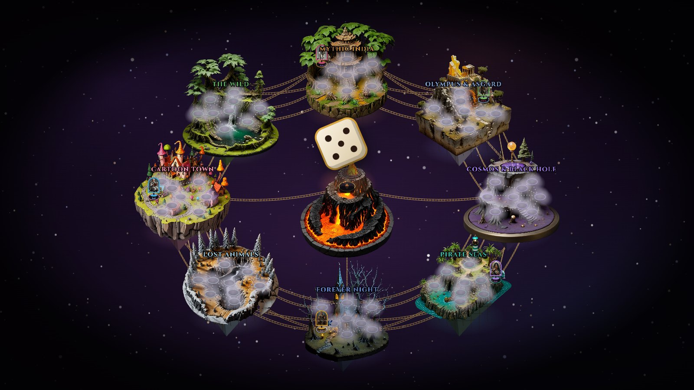
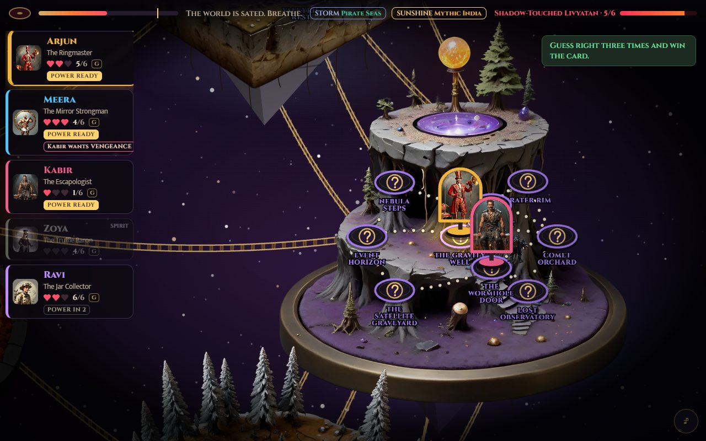
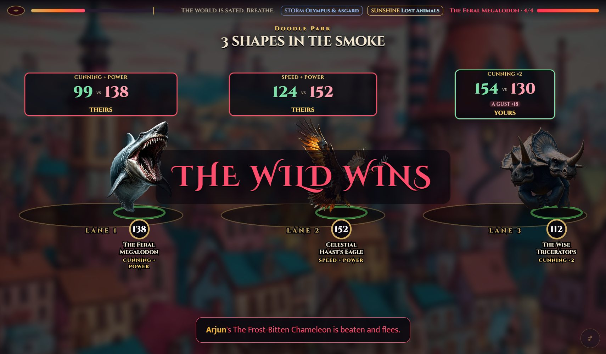
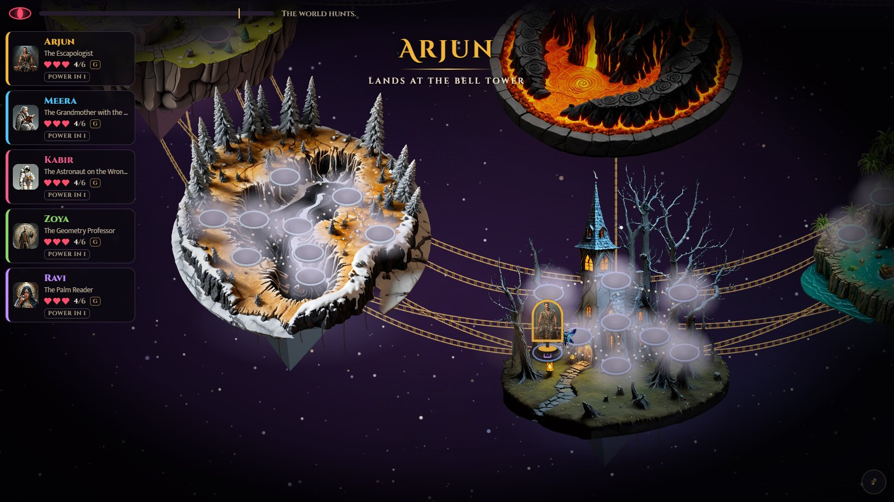

<div align="center">

# PRALAYA

### The world ends. One walks out.

**A cruel adventure survival game for 2 to 6 friends around one laptop.**
Fall into a broken world of floating islands. Tame what roars. Trust nothing.
Three hearts. The last one standing walks out, if the world lets them.

### [▶ Play it now in your browser](https://shv27.github.io/pralaya/)

Free · no sign-up · no download · about 14 minutes with two players, 20 with three, 25 with four, 32 with six · 512 painted creatures · 80 chance cards · 30 relics



</div>

---

## The game in one breath

An antique board lies on the table. Press **Begin** and the camera dives into it: through the clouds, down onto a **broken world**
of eight painted islands drifting over the stars: Mythic India, Olympus and Asgard, the Cosmos, the Pirate Seas, Forever Night,
the valley of Lost Animals, Cartoon Town and The Wild. In the middle burns **the Burning Heart**, a volcano with a bridge to every
land: step into it and it throws you somewhere **of its own choosing**, safe ground or a land already falling. A gamble.

Every turn you **roll the die, and every place your roll reaches lights up: you choose where to go.** Seventy-three places, and
**every one of them is sealed**. What waits inside is drawn **the moment someone steps on it**, blind, from the whole pool: the
same place can hold a lair now and a chance card next time. Nothing on the map can be learned, counted or farmed. Behind a seal: **lairs, witches with three potions,
riddles, caches, wild nests, the Oracle's Ladder** (guess higher or lower three times and win the creature), **a lone beast** to
tame one on one, **the Altar of Bargains**, **the Masked Trader** (one of yours for one you cannot see: a common, or a legend),
**the Cave of Echoes** (go deeper for another creature, until the roof comes down), **the Bridge of Trust** (you and a rival
choose in secret: share, or take), or a **chance card** you must obey.
**the Gauntlet** (lone beasts one at a time: step out, or face the next), **the Challenge Ring** (call any rival into the
ring), **the Oath Stone** (swear an alliance: allies share every battle won, until the day they meet and each chooses in
secret to keep the oath or betray it), **the Fishing Pier**, or **the Beast's Shrine** (ring the bell, and the beast hunts the rival you name). If a rival stands where your roll reaches, the place
says so: **DUEL**, and **LAST HEART** if one more win puts them out.

## The world is cruel

Before your turn, **the land itself may strike**: a meteor shower, a rogue wave, a banshee's wail. Your deck is shuffled, the top
card stands in the way, and it needs one number. Stop it and a creature of that land follows you. Fail and the land takes it.

The chance cards are worse. **The King's Ransom**: lose a heart and the mightiest creature in the world is destroyed, or keep your
heart and its owner takes your best. **The Devil's Bargain**: a heart for you and a legend for the leader, or blood to bring them
down. **The Achilles' Heel**: strike a rival's weakest stat, and if you beat it they bleed. **The Sinking Ship**: choose who goes
down with you. Relics that lift one creature for good, hexes that ruin one, ropes that tie your fate to a rival's, bets that
only pay if your enemy wins. **The Mirror** turns your win into a rival's loss. **The Blood Pact** gives you both a creature, or
takes a heart from each. **Wanted** puts a price on a head. **The Dead Man's Switch** makes whoever takes your heart pay one back.
Take someone's heart and they will want **vengeance**: your next duel, the winner takes two. **The Dragon's Teeth**: six teeth, one
bites, and the whole table pulls in turn (or pays to pass). **The Black Market** auctions a legend for creatures. **The
Colosseum** makes everyone call your next battle. **The Sweepstake** throws everyone's weakest into a pot for the next winner.
**The Dark Pact**: take a creature, or chain yourself to a rival's next battle so that if they lose it you *both* bleed.
**The Assassin's Contract**: write a name in secret; if that hero loses a heart before your next turn, you gain one.
**The Liar's Chest**: only you see what is inside (a rare creature, or a curse); offer it to a rival and lie with a straight face.
**Blade, Shield, Spell**: read your friend's eyes. **The Grand Melee**, **King of the Hill**, **the Pickpocket**, **All In**,
**Heads or Tails**, **the Crossroads Demon** (a legend now, the bill in two rounds), **the Beast's Whistle**. **The Loan Shark**, **the Insurance**, **the Gambler's Stairs**, **the Oracle's Number**, **the Dice Duel**, **the Champion's
War**, **Feed the Volcano**. Somewhere in the deck lies **a Miracle**, and just as rarely, **the Pharaoh's Curse**. Some cards make you the luckiest person alive. Most make you choose who
suffers.



Down to two creatures? Then it is two against two. One? One on one. **None at all?** Nothing can fight you, so you **run**:
one die in front of everyone, 4 or more and you get away, less and a heart goes. And at the end of every turn with empty hands
you may play **the Last Gamble**: call a rival's next battle and choose your stake. A heart (right: a creature) or **your whole
life** (right: two creatures and a heart; wrong: you are out). The whole table holds its breath for someone else's fight.

Some nights the moon turns red: in a **Blood Moon** round every battle counts double, so one fight can cost a creature and a
heart at once, or win you two. Somewhere under a seal waits **the Wheel of Pralaya**: three reels stop one by one (who, what,
with whom) and hearts or whole collections change hands. And when a hero falls, they get one roll at **Death's Door**: a 5 or
a 6 and they stand back up on one heart, by a hair, in front of everyone.

## Battles are Top Trumps, with both hands on the wheel

When creatures burst out, the camera cuts to the land's painted arena. You see their faces, never their order. Pick your
fighters, set the lanes, and **call a stat for each lane**: POWER, SPEED, SIZE, CUNNING, MAGIC or TERROR. The other side calls
too, and **both calls count**: in every lane, each card adds both numbers, and the bigger total wins. The wild has no brain: it
calls **blind**, never looking at your card, one of its own three best stats, like a beast that fights with what it has. The only
luck in a lane is a **twist**, and it falls on either side by pure chance: a gust, mud, the crowd roaring. Nothing secretly
favours the wild. You turn each lane over yourself, one tap at a time, and a legendary card never makes a battle safe.



## Creatures that grow, and the fear of losing them

Every lane a creature wins for you is remembered. Two wins and it **ascends** (every number +8); four and it becomes **fabled**
(+8 again). Add a relic (+6 to +26) and one beloved card can carry a whole match. But the proud fall first: lose a fight to the
wild and an ascended creature that lost its lane is the one that goes, and a rival who beats you in a duel takes the proud ones
first. The more it has done for you, the more it hurts to lose it.

## A deck nobody can learn

**512 painted creatures**, 64 to a land: the villains of the Puranas and the ghosts of Bengal and Kerala, the gods and monsters
of Greece, Asgard and Egypt, the sky beasts of China, the Maya and Mesopotamia, the sea legends of Japan, Orkney and Chile, the
night folk of the Philippines, Malaysia, Korea, the Slavs, the Celts and West Africa, dinosaurs and the giants of the ice age,
the cryptids of every jungle, and a crowd of affectionate cartoon parodies. Every match deals them anew: every number is
re-rolled, the stat a creature is famous for can move, and each one arrives in one of **13 forms and 11 epithets**. That is
more than **70,000 different cards**. There is no memory and no engine choosing what you see: each land's creatures are one
honest shuffled deck per match, and repeats across matches happen only the way they happen at a card table, by chance.

## Fair, and it can prove it

Luck in PRALAYA is wild, but it is never aimed. `node scripts/fairness.ts` plays a thousand matches with the same careless hand
in every seat and counts. Over 1,000 four-player matches each seat won 24.2–26.6% (chi-square 1.0), the die's faces came up
16.3–17.1% each, every one of 25,839 wild calls was one of the beast's own best three (none ever chosen against your card), and
the twists of luck fell 50.5% on the hero's side. Who moves first is drawn by lot, the world eats whichever land chance points at,
the Final Turns blessing falls on a name drawn by lot, and every tie is broken at random.

The chance deck works like a real deck of cards: **one copy of each of the 80 cards**, shuffled, and nothing comes round again
until the whole deck has been dealt. `node scripts/variety.ts` deals a thousand matches: every card turned up 51–89 times
(chi-square 75.7 on 79 degrees of freedom, as even as a fair die), no card ever came twice in one match, and the places landed
on followed the pool exactly (a chance card 17.4%, a lair 8.7%, every other kind 4.1–4.6%). Repeats happen only the way they happen with real cards: by chance.

## The Last Stand

The last one standing does not simply win. **The world only lets you out with four creatures**, or two more than you hold.
Fall short and the clock starts: five turns to find them, while every fallen player lays a trap on the map before each of your turns. Walk out, or the world keeps
you, and the fallen win together. Nobody is ever truly out of the game: every round one fallen hero, drawn by lot, whispers
from beyond to someone still alive, **a blessing (+2) or a curse (−2) on their next roll**. Help a friend, or settle a score.

## Heroes, the boss and the hunt

Luck deals each player one of twelve absurd heroes with an **active power** (it recharges every three turns, or two for the
powers that only move you) and a funny weakness everyone can see. Over 3,000 four-player matches every hero won 22–27% of the
time: no power decides a match, no weakness ruins one. `node scripts/audit.ts` shows that no system (the beast, the hunts, the
falling ground, the land's strikes, the duels) lands on any one hero more often than chance would. Beasts you flee from break loose and **hunt** you (they gather for a round first, so you can run). A **world
beast** wakes and hunts in the open: at the end of every round it **rolls its own die** in front of everyone and runs at the
nearest hero, and it fights only whoever it stops on, or whoever steps onto it. After a fight it rests a round and turns to
someone else. One health bar for the whole table; whoever lands the last hit keeps it. The ground falls into the stars (if it is
yours, a heart goes with it), stampedes cross whole
islands, storms and sunshine move every round, and twice a match **the table flips**.



## How to play

| | |
|---|---|
| **Players** | 2 to 6 on one laptop, tablet or phone. Type your names; luck deals each of you a hero. |
| **Your turn** | The land may strike first. Then use your power if it is ready, roll, pick any glowing place your roll reaches, and face the seal. |
| **Choices** | Every choice is a big button with its number. Mouse, touch and keyboard all work (number keys, Enter, Space). |
| **Secrets** | When two players clash, each sets their order and calls behind a pass-the-laptop cover screen. |
| **Winning** | Be the last one standing, then survive the Last Stand. If the survivor fails, the fallen win together. |

## Built with

- **PixiJS 8** renders the world and the arena; **GSAP 3** times every move.
- **A deterministic rules engine** (TypeScript) plays the match as a stream of beats and questions; the screen catches up one
  beat at a time, so it never shows the future. Property tests check that every match ends with one result, that the same seed
  replays the same match, that no lane is ever one card against nobody, and that every creature has its own painting.
- **A card lab and a simulator** play thousands of battles and matches to tune the cards, the cruelty and the luck.
- **The anthem** was made with ACE-Step (open weights) and plays through the whole match. Works offline once loaded, and
  installs to the home screen.

## Run it yourself

```bash
npm install
npm run dev        # http://localhost:5173
npm run check      # typecheck + unit and property tests
npx playwright test  # a whole match on laptop, tablet and phone sizes
```

## Credits

The paintings were generated by the studio with free models (FLUX.1 schnell, Juggernaut XL and AlbedoBase XL on the AI Horde),
then picked and cut out by hand (BiRefNet-lite) and dedicated **CC0**: every file is listed in `assets/LICENSES.json`. The anthem
was generated with ACE-Step (Apache-2.0). Fonts: Cinzel, Cinzel Decorative and Mukta (SIL Open Font License). GSAP is used under
its standard no-charge licence.

Mythology is treated with respect: villains of the epics can be fought, sacred beings only ever bless, and gods who are
worshipped today never appear as characters.
